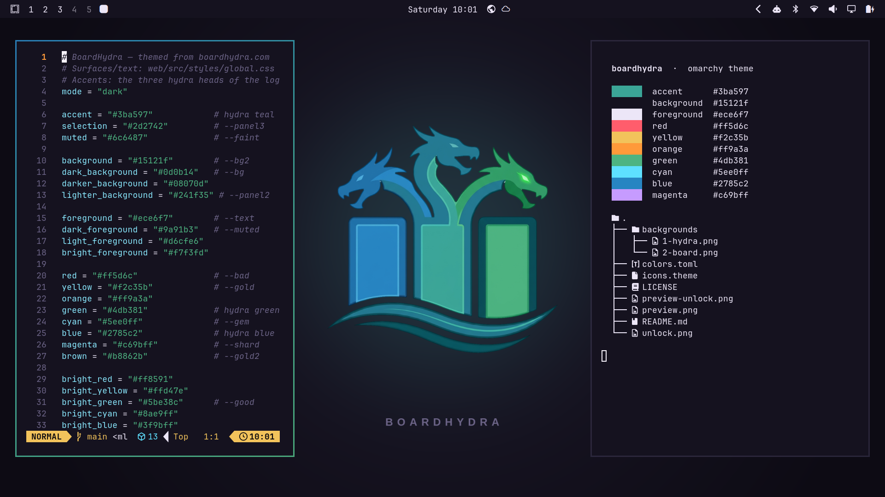

# BoardHydra theme for Omarchy

A violet-black and gold [Omarchy](https://omarchy.org/) theme based on [BoardHydra](https://boardhydra.com), with hydra and kanban-board wallpapers.



## Install

```bash
omarchy theme install https://github.com/MadeBySaints/omarchy-boardhydra-theme.git
```

The theme installs as `boardhydra` and is applied right away. You can switch back to it later with `omarchy theme set boardhydra`.

## Update

```bash
omarchy theme update
```

## Wallpapers

- `1-hydra.png`: the BoardHydra hydra
- `2-board.png`: a kanban board with painted columns. It is meant to be used with the [BoardHydra Desk](https://github.com/MadeBySaints/omarchy-boardhydra-desk) shell plugin, which draws live cards on top of it.

Use `omarchy theme bg next` to cycle between them.

## Remove

```bash
omarchy theme remove boardhydra
```

## License

The config files (`colors.toml`, `icons.theme`) are MIT licensed. The wallpapers and unlock artwork are © madebysaints, all rights reserved: you can use them as part of this theme but not reuse or modify them elsewhere. See [LICENSE](LICENSE) for details.
